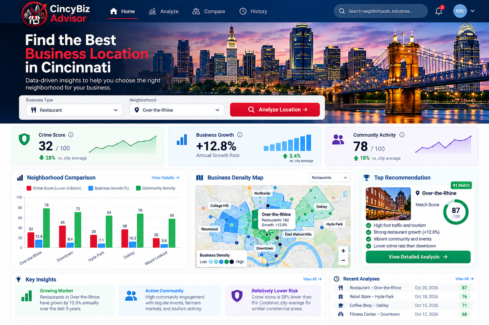
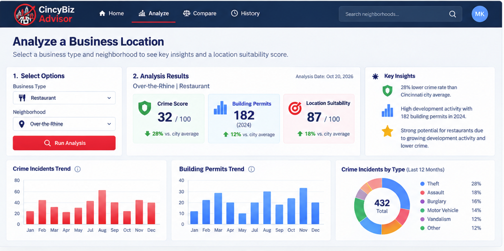
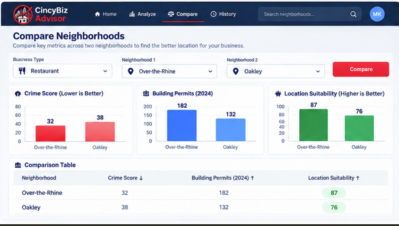
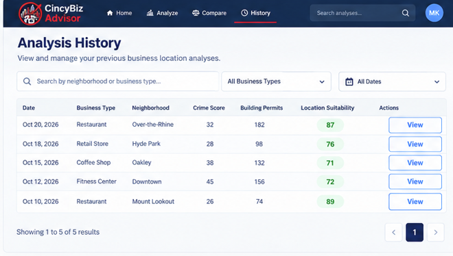

# CincyBiz Advisor

## Design Document

### Team Members

- Priya Kachhia
- Alisha Rana
- Raj Aware

---

# Introduction

Have you ever wondered which neighborhood in Cincinnati would be the best place to start a business? Choosing a location can be difficult because there are many factors to consider, such as crime rates, community activity, and neighborhood growth.

CincyBiz Advisor helps users find and compare Cincinnati neighborhoods using public city data. Instead of searching through different websites and datasets, users can view important information in one place and make better decisions about where to open a business.

CincyBiz Advisor can help users:

- Search Cincinnati neighborhoods
- Analyze neighborhoods using crime and development data
- Compare neighborhoods side-by-side
- View business location recommendations
- See neighborhood growth trends
- Save previous analyses
- Access neighborhood data through a JSON API

The goal of this project is to provide users with useful information that can help them evaluate different locations before starting a business.

---

# Logo

The logo combines Cincinnati landmarks, a storefront, and an upward arrow. The storefront represents local businesses, while the arrow represents growth and business opportunities in Cincinnati.

---

# Storyboard

### Home Page

The Home page allows users to:

- Select a business type
- Select a neighborhood
- Run a location analysis
- View neighborhood statistics
- View recommendations
- View recent analyses

## Analyze Page

The Analyze page allows users to select a business type and neighborhood and view crime data, building permit activity, location suitability scores, and trend visualizations.

---

## Compare Page

The Compare page allows users to compare two neighborhoods side-by-side using crime statistics, permit activity, and location suitability scores.

---

## History Page

The History page allows users to view and search previous business location analyses that have been saved to the database.

---

# GitHub Project

GitHub Projects will be used to organize and track development throughout the semester.

Project columns:

- To Do
- In Progress
- Review
- Done

Planned tasks include:

- Set up ASP.NET Core project
- Build Home page
- Build Analyze page
- Build Compare page
- Build History page
- Connect crime dataset
- Connect building permit dataset
- Create location scoring system
- Create database tables
- Create REST API endpoints
- Deploy application to Azure

---

# Functional Requirements

## Requirement 100.0: Search for Neighborhoods

### Scenario

As a user interested in opening a business, I want to search Cincinnati neighborhoods so that I can find locations I want to analyze.

### Dependencies

- Neighborhood data is available.

### Assumptions

- Neighborhood names are stored correctly.
- Users can search using uppercase or lowercase text.

### Examples

#### 100.1

**Given** neighborhood data is available

**When** I search for "Over-the-Rhine"

**Then** I should receive a result containing:

Neighborhood: Over-the-Rhine

#### 100.2

**Given** neighborhood data is available

**When** I search for "Oakley"

**Then** I should receive a result containing:

Neighborhood: Oakley

#### 100.3

**Given** neighborhood data is available

**When** I search for "abcdefgh123"

**Then** I should receive zero results

---

## Requirement 101.0: Analyze a Neighborhood

### Scenario

As a user interested in opening a business, I want to analyze a neighborhood so that I can better understand whether it may be a good location.

### Dependencies

- Crime data is available.
- Building permit data is Public city data is accurate.

### Examples

#### 101.1

**Given** I select Restaurant as the business type

**And** I select Over-the-Rhine as the neighborhood

**When** I click Analyze

**Then** I should see:

- Crime information
- Building permit activity
- Location score

#### 101.2

**Given** I select Coffee Shop as the business type

**And** I select Oakley as the neighborhood

**When** I click Analyze

**Then** I should see Oakley's analysis results

#### 101.3

**Given** no neighborhood is selected

**When** I click Analyze

**Then** I should be prompted to select a neighborhood

#### 101.4

**Given** crime data is unavailable

**When** I run an analysis

**Then** I should receive an error message

---

## Requirement 102.0: Compare Neighborhoods

### Scenario

As a user interested in choosing between locations, I want to compare neighborhoods so that I can identify differences between them.

### Dependencies

- Analysis results are available.

### Assumptions

- Users select two neighborhoods.

### Examples

#### 102.1

**Given** I select Over-the-Rhine

**And** I select Oakley

**When** I click Compare

**Then** I should see a side-by-side comparison of both neighborhoods

#### 102.2

**Given** comparison data exists

**When** I open the Compare page

**Then** I should see charts and summary statistics for both neighborhoods

#### 102.3

**Given** I select Hyde Park in both neighborhood fields

**When** I click Compare

**Then** I should be asked to select two different neighborhoods

---

## Requirement 103.0: Save Analysis History

### Scenario

As a user, I want to save analyses so that I can access them later.

### Dependencies

- MySQL database is available.

### Assumptions

- Users may save multiple analyses.

### Examples

#### 103.1

**Given** I have completed an analysis

**When** I click Save Analysis

**Then** the analysis should be stored in the database

#### 103.2

**Given** a saved analysis exists for Oakley

**When** I search Oakley in the History page

**Then** I should see the saved analysis

#### 103.3

**Given** no saved analyses exist for Westwood

**When** I search for Westwood

**Then** I should see "No saved analyses found"

---

# Data Sources

### Source 1

**Cincinnati Open Data Portal – Reported Crime Data**

Used for:

- Crime statistics
- Crime trends
- Neighborhood safety indicators

### Source 2

**Cincinnati Open Data Portal – Building Permits**

Used for:

- Development activity
- Permit trends
- Neighborhood growth indicators

### Source 3

A JSON API developed by another student group will be integrated later in the semester.

---

# Database

## Neighborhoods Table

| Field | Description |
|---------|---------|
| Id | Primary Key |
| Name | Neighborhood Name |

## AnalysisHistory Table

| Field | Description |
|---------|---------|
| Id | Primary Key |
| NeighborhoodId | Foreign Key |
| BusinessType | Selected Business Type |
| CrimeIncidentCount | Crime Total |
| BuildingPermitCount | Permit Total |
| SuitabilityScore | Location Score |
| PeriodStart | Start Date |
| PeriodEnd | End Date |
| CreatedAt | Date Saved |

### Relationship

One Neighborhood can have many AnalysisHistory records.

---

# Team Composition

### Scrum Roles

**Product Owner:** Priya Kachhia

**Frontend Developer:** Raj Aware

**Backend / Integration Developer:** Alisha Rana

**Database Developer:** Priya Kachhia

---

# Weekly Meeting

**Day:** Sunday

**Time:** 4 pm

**Format:** Microsoft Teams

During each meeting we will:

- Review completed work
- Update GitHub tasks
- Discuss issues
- Plan work for the following week
