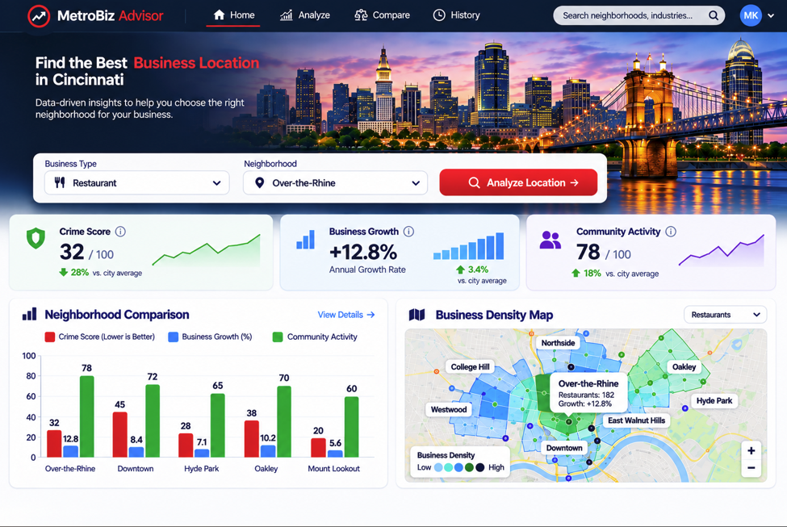
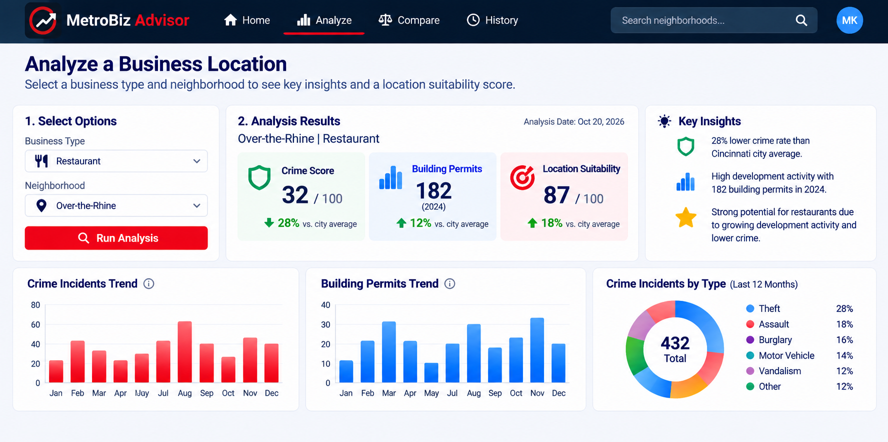
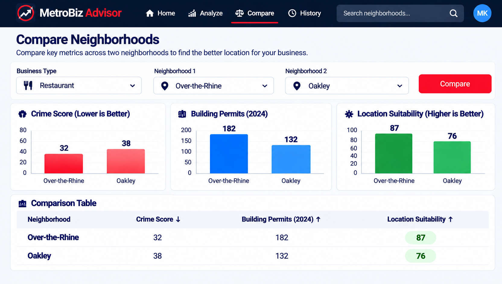
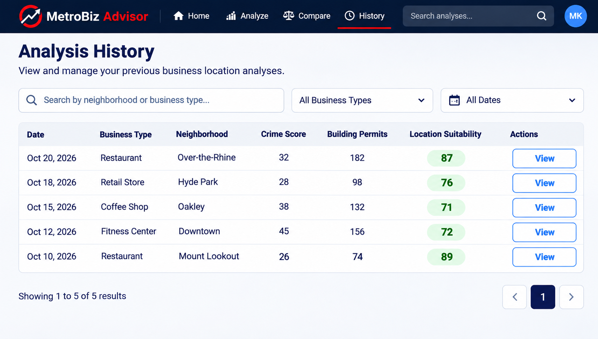

# MetroBiz Advisor

## Design Document

### Team Members

- Priya Kachhia
- Alisha Rana
- Raj Aware

---

## Introduction

Have you ever wondered which neighborhood in your city would be the best place to start a business? Choosing a location can be difficult because there are many factors to consider, such as crime rates, community activity, and neighborhood growth.

MetroBiz Advisor helps users find and compare neighborhoods using public city data. Cincinnati is our launch city, but the design can be reused for any metropolitan area that publishes open data. Instead of searching through different websites and datasets, users can view important information in one place and make better decisions about where to open a business.

MetroBiz Advisor can help users:

- Search neighborhoods by name
- Analyze neighborhoods using crime and development data
- Compare neighborhoods side-by-side
- View business location recommendations
- See neighborhood growth trends
- Save previous analyses
- Connect with other entrepreneurs interested in the same neighborhood
- Access neighborhood data through a JSON API

The goal of this project is to provide users with useful information that can help them evaluate different locations before starting a business.

---

## Project Logo

The logo is a single upward arrow rising out of an open circle. The circle represents a city and its neighborhoods, and the arrow represents growth and business opportunity. Using only two shapes keeps the logo readable at any size, from a browser tab icon to a page header.

---

## Storyboard

Design revision: The Home page will lead with one primary action: choose a business type and a neighborhood, then click Analyze. The header will be reduced in height, and statistics, recommendations, and recent analyses will move below that action so nothing competes with it.

### Home Page

The Home page allows users to:

- Select a business type
- Select a neighborhood
- Run a location analysis
- View neighborhood statistics
- View recommendations
- View recent analyses

### Analyze Page

The Analyze page allows users to select a business type and neighborhood and view crime data, building permit activity, location suitability scores, and trend visualizations.

### Compare Page

The Compare page allows users to compare two neighborhoods side-by-side using crime statistics, permit activity, and location suitability scores.

### History Page

The History page allows users to view and search previous business location analyses that have been saved to the database.

### Community Page
.

The Community page lets users post and reply in a discussion board for each neighborhood and list the type of business they hope to open there. Other entrepreneurs can find them as potential partners, co-founders, or neighbors.

---

## GitHub Project

GitHub Projects will be used to organize and track development throughout the semester.

Project columns:

- To Do
- In Progress
- Review
- Done

Planned tasks include:

- Set up ASP.NET Core project
- Build Home page
- Build Analyze page
- Build Compare page
- Build History page
- Build Community page (neighborhood discussion boards and entrepreneur profiles)
- Connect crime dataset
- Connect building permit dataset
- Create location scoring system
- Create database tables
- Create user, business interest, and discussion post tables
- Create REST API endpoints
- Deploy application to Azure

---

## Functional Requirements

### Requirement 100.0: Search for Neighborhoods

**Scenario**

As a user interested in opening a business, I want to search neighborhoods by name so that I can find locations I want to analyze.

**Dependencies**

- Neighborhood data is available.

**Assumptions**

- Neighborhood names are stored correctly.
- Users can search using uppercase or lowercase text.

**Examples**

**100.1**

Given neighborhood data is available

When I search for "Over-the-Rhine"

Then I should receive a result containing:

Neighborhood: Over-the-Rhine

**100.2**

Given neighborhood data is available

When I search for "Oakley"

Then I should receive a result containing:

Neighborhood: Oakley

**100.3**

Given neighborhood data is available

When I search for "abcdefgh123"

Then I should receive zero results

---

### Requirement 101.0: Analyze a Neighborhood

**Scenario**

As a user interested in opening a business, I want to analyze a neighborhood's crime incidents, building permit activity, and location suitability score for a specific business type so that I can better understand whether it may be a good location.

**Dependencies**

- Crime data is available.
- Building permit data is available.
- Public city data is accurate.

**Examples**

**101.1**

Given I select Restaurant as the business type

And I select Over-the-Rhine as the neighborhood

And the reporting period is January 1, 2025 to December 31, 2025

And the city data shows 412 crime incidents and 87 building permits for Over-the-Rhine in that period

When I click Analyze

Then I should see:

- Crime incidents: 412
- Building permits issued: 87
- Location score: 72 out of 100 for a Restaurant in Over-the-Rhine

**101.2**

Given I select Coffee Shop as the business type

And I select Oakley as the neighborhood

And the reporting period is January 1, 2025 to December 31, 2025

And the city data shows 138 crime incidents and 41 building permits for Oakley in that period

When I click Analyze

Then I should see Oakley's analysis results:

- Crime incidents: 138
- Building permits issued: 41
- Location score: 64 out of 100 for a Coffee Shop in Oakley

**101.3**

Given no neighborhood is selected

When I click Analyze

Then I should be prompted to select a neighborhood

**101.4**

Given the crime data source cannot be reached

When I select Restaurant and Over-the-Rhine and click Analyze

Then I should see the message "Crime data is currently unavailable. Please try again later." and no location score is displayed

---

### Requirement 102.0: Compare Neighborhoods

**Scenario**

As a user interested in choosing between locations, I want to compare two neighborhoods' crime incidents, building permit activity, and location suitability scores for the same business type so that I can identify which one is a better fit.

**Dependencies**

- Analysis results are available.

**Assumptions**

- Users select two neighborhoods.
- Both neighborhoods are analyzed for the same business type and reporting period.

**Examples**

**102.1**

Given I select Over-the-Rhine

And I select Oakley

And I select Restaurant as the business type

And Over-the-Rhine has 412 crime incidents, 87 building permits, and a location score of 72

And Oakley has 138 crime incidents, 41 building permits, and a location score of 58

When I click Compare

Then I should see a side-by-side comparison showing:

- Crime incidents: Over-the-Rhine 412, Oakley 138
- Building permits issued: Over-the-Rhine 87, Oakley 41
- Location score (Restaurant): Over-the-Rhine 72, Oakley 58

**102.2**

Given Over-the-Rhine and Oakley have been compared for a Restaurant

When I open the Compare page

Then I should see a bar chart of crime incidents (412 and 138) and building permits (87 and 41), plus a summary line for each neighborhood showing its location score (72 and 58)

**102.3**

Given I select Hyde Park in both neighborhood fields

When I click Compare

Then I should be asked to select two different neighborhoods

---

### Requirement 103.0: Save Analysis History

**Scenario**

As a user, I want to save analyses so that I can access them later.

**Dependencies**

- MySQL database is available.

**Assumptions**

- Users may save multiple analyses.

**Examples**

**103.1**

Given I have analyzed Oakley for a Coffee Shop for January 1, 2025 to December 31, 2025, with 138 crime incidents, 41 building permits, and a location score of 64

When I click Save Analysis

Then a new AnalysisHistory record should be stored with:

- NeighborhoodId: the Id of Oakley; BusinessType: Coffee Shop
- CrimeIncidentCount: 138; BuildingPermitCount: 41
- SuitabilityScore: 64
- PeriodStart: 2025-01-01; PeriodEnd: 2025-12-31; CreatedAt: the date and time of saving

**103.2**

Given a saved analysis exists for Oakley (Coffee Shop, 138 crime incidents, 41 building permits, score 64)

When I search Oakley in the History page

Then I should see one row showing Oakley, Coffee Shop, 138, 41, 64, and the date it was saved

**103.3**

Given no saved analyses exist for Westwood

When I search for Westwood

Then I should see "No saved analyses found"

---

### Requirement 104.0: Connect with Other Entrepreneurs

**Scenario**

As a user interested in opening a business in a specific neighborhood, I want to post to a neighborhood discussion board and share my business interest so that I can connect with other entrepreneurs, potential partners, and local advice.

**Dependencies**

- User accounts are available.
- MySQL database is available.

**Assumptions**

- Users must be signed in to post.
- Each discussion post belongs to one neighborhood.

**Examples**

**104.1**

Given I am signed in as Maria

And I am viewing the Oakley discussion board

When I post "Looking for a partner to open a coffee shop near Madison Road"

Then I should see the post at the top of the Oakley board with author Maria and today's date

And a DiscussionPosts record should be stored with NeighborhoodId = Oakley and UserId = Maria

**104.2**

Given Maria and Sam are signed-up users

And Maria has listed Coffee Shop in Oakley as her business interest, looking for a partner

And Sam has listed Coffee Shop in Oakley as his business interest, looking for a partner

When Maria clicks Find Entrepreneurs on the Oakley page

Then I should see Sam listed with Coffee Shop, Oakley, and "Looking for: partner"

**104.3**

Given I am not signed in

When I try to post on the Oakley discussion board

Then I should be asked to sign in before posting

---

## Data Sources

### Source 1

**Cincinnati Open Data Portal – Reported Crime Data**

Used for:

- Crime statistics
- Crime trends
- Neighborhood safety indicators

### Source 2

**Cincinnati Open Data Portal – Building Permits**

Used for:

- Development activity
- Permit trends
- Neighborhood growth indicators

### Source 3

A JSON API developed by another student group will be integrated later in the semester.

---

## Proprietary Data

The crime, building permit, and partner API data above are read from public feeds, so we will not store most of it. The data we will own comes from our users: saved analyses (which show which business types people are exploring in which neighborhoods), entrepreneur business interests, and neighborhood discussion posts. This user-generated data powers the entrepreneur matchmaking feature and is what makes MetroBiz Advisor valuable beyond the public datasets.

---

## Database

### Neighborhoods Table

| Field | Description |
|---|---|
| Id | Primary Key |
| Name | Neighborhood Name |

### AnalysisHistory Table

| Field | Description |
|---|---|
| Id | Primary Key |
| NeighborhoodId | Foreign Key |
| BusinessType | Selected Business Type |
| CrimeIncidentCount | Crime Total |
| BuildingPermitCount | Permit Total |
| SuitabilityScore | Location Score |
| PeriodStart | Start Date |
| PeriodEnd | End Date |
| CreatedAt | Date Saved |

### Users Table

| Field | Description |
|---|---|
| Id | Primary Key |
| DisplayName | Name shown on posts |
| Email | Sign-in email |
| CreatedAt | Date joined |

### BusinessInterests Table

| Field | Description |
|---|---|
| Id | Primary Key |
| UserId | Foreign Key |
| NeighborhoodId | Foreign Key |
| BusinessType | Type of business the user wants to open |
| LookingFor | Partner, investor, advice, or space |
| CreatedAt | Date listed |

### DiscussionPosts Table

| Field | Description |
|---|---|
| Id | Primary Key |
| NeighborhoodId | Foreign Key |
| UserId | Foreign Key |
| ParentPostId | Id of the post being replied to (empty for a new post) |
| Body | Post text |
| CreatedAt | Date posted |

### Relationship

One Neighborhood can have many AnalysisHistory records, BusinessInterests, and DiscussionPosts.

One User can have many BusinessInterests and DiscussionPosts.

One DiscussionPost can have many replies, which are DiscussionPosts that point to it through ParentPostId.

---

## Team Composition

### Scrum Roles

**Product Owner:** Priya Kachhia

**Frontend Developer:** Raj Aware

**Backend / Integration Developer:** Alisha Rana

**Database Developer:** Priya Kachhia

---

## Weekly Meeting

**Day:** Sunday

**Time:** 4 pm

**Format:** Microsoft Teams

During each meeting we will:

- Review completed work
- Update GitHub tasks
- Discuss issues
- Plan work for the following week
